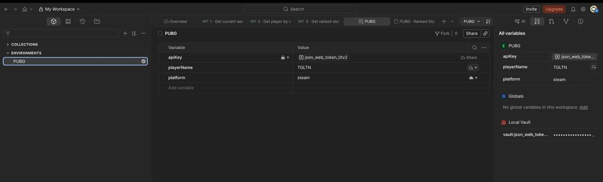
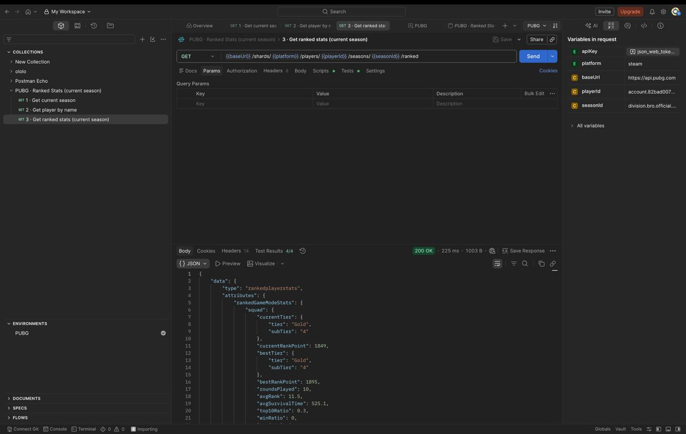

# Task 1 - PUBG API ranked stats (Postman)

[Back to overview](../readme.md)

## Task

Create a Postman collection to get ranked stats for a single player for the current season, using the [PUBG API](https://documentation.pubg.com/en/introduction.html).

- It should be easy to import the solution into Postman.
- It should be possible to check the stats of another player with just 1 change.

## Files

- [PUBG-Ranked-Stats.postman_collection.json](PUBG-Ranked-Stats.postman_collection.json): the collection
- [PUBG.postman_environment.json](PUBG.postman_environment.json): environment with `apiKey`, `playerName` (TGLTN) and `platform` (steam)
- [screenshots](screenshots/): the collection running in Postman

## How to run

1. Import both JSON files into Postman.
2. Select the **PUBG** environment (top-right).
3. Run the collection, or send requests 1, 2, 3 in order.

To check another player, change `playerName` in the PUBG environment and run again.

## How it works

1. **Get current season:** `GET /shards/{platform}/seasons`. Saves the id of the season with `isCurrentSeason = true` to `seasonId`.
2. **Get player by name:** `GET /shards/{platform}/players?filter[playerNames]={playerName}`. Saves the account id to `playerId`.
3. **Get ranked stats:** `GET /shards/{platform}/players/{playerId}/seasons/{seasonId}/ranked`. Uses both ids from the previous requests.

The API key is sent as a Bearer token, set on the collection. Each request has tests for the status code and the main response fields.

## Screenshots

The PUBG environment in Postman:

Request 3 for TGLTN: 200 OK, 4/4 tests passed. `playerId` and `seasonId` (right panel) were filled by requests 1 and 2.

